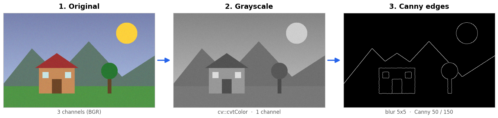
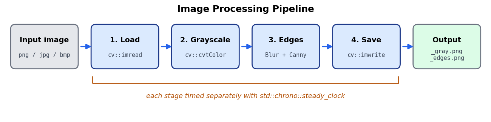

# Image Processing System

C++17 / OpenCV command-line tool for Linux. Loads images, converts them to grayscale, runs Canny edge detection and times each stage.



## Features

- Load png / jpg / bmp / tiff / webp images
- Grayscale conversion (BGR, BGRA, or alredy-gray input)
- Canny edge detection with optional Gaussian blur first
- Timing for load, grayscale, Canny and save
- Batch mode for a whole folder, with averages and CSV export
- Benchmark across image sizes, single vs multi-threaded

## How it works



## Build (Ubuntu / WSL)

```bash
sudo apt install -y build-essential cmake libopencv-dev

cmake -S . -B build -DCMAKE_BUILD_TYPE=Release
cmake --build build -j$(nproc)
ctest --test-dir build --output-on-failure
```

Or run everything with `./scripts/run_all.sh`.

## Usage

```bash
./build/imgproc process photo.jpg -o output
./build/imgproc batch ./images -o output --csv results/batch.csv
./build/imgproc bench --sizes 640x480,1920x1080,3840x2160 --iterations 100
./build/imgproc generate samples --count 12
```

Canny options: `--low 50 --high 150 --blur 5` (`--blur 0` turns off the blur), `--threads N` for OpenCV threads.
