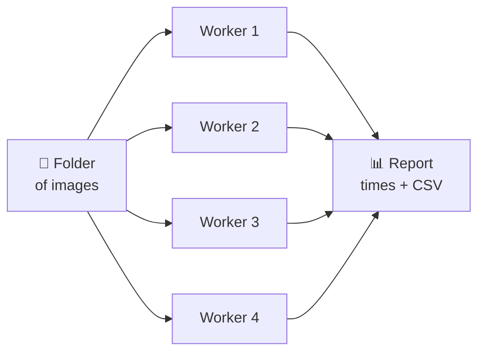

# Image Processing System

A C++ command-line tool that turns images into edge maps with OpenCV (grayscale → blur → Canny edge detection) and measures how fast each step runs.


## Why I built this

I wanted to understand how image processing works, beyond just calling a library. I had three goals:

1. **Learn how the algorithms behave.** See how blur and Canny thresholds change the edges that are found.
2. **Learn to measure and improve performance.** Time the pipeline on small, medium and large images, and make it faster with multithreading.
3. **Learn to write reliable software.** Test the program against bad input (missing files, broken images, odd sizes) with GoogleTest.

## What I learned

- **Image processing:** how grayscale conversion, Gaussian blur and Canny edge detection work, and how to tune their parameters. Blur removes noise, but too much blur also removes real edges.
- **Performance and concurrency:** how to profile with `std::chrono` and process images in parallel with `std::thread`. More threads isn't always faster: large images stopped speeding up after 4 workers.
- **Testing and error handling:** how to write GoogleTest tests and handle errors with clear messages instead of crashes.
- **C++ tooling:** C++17, CMake, CTest and building on Linux (WSL).

## Features

- Process one image or a whole folder, with timing for every step
- Compare 32 blur and threshold settings side by side
- Process many images at once (`--workers`) and compare that with sequential processing
- 112 automated tests

## How it works

Every image goes through the same 5 steps, and each step is timed:


| Step | What it does | Why |
|------|--------------|-----|
| Grayscale | Turns colour into brightness only | Edges are changes in brightness, so colour isn't needed |
| Blur | Averages each pixel with its neighbours | Removes small noise that would show up as fake edges |
| Canny | Marks pixels where brightness changes sharply | Gives a clean black-and-white outline of objects |

**Processing a folder faster:** instead of one image at a time, several workers each take the next image from the list. No image depends on another, so they can all run at the same time.



## Build and run

```bash
sudo apt install -y build-essential cmake libopencv-dev libgtest-dev

cmake -S . -B build -DCMAKE_BUILD_TYPE=Release
cmake --build build -j$(nproc)

./build/imgproc process data/building.jpg      # one image -> output/
./build/imgproc compare data/building.jpg      # compare parameter settings
./build/imgproc generate samples               # make some test images
./build/imgproc batch samples --workers 0      # a folder, using all CPU threads
./build/imgproc scale                          # sequential vs parallel benchmark
ctest --test-dir build                         # run the tests
```

## Results

- **Parameters:** a light blur cut false edges caused by noise from 13% of the image to under 1%.
- **Speed:** processing several images at once was up to **4.8× faster** than one at a time.
- **Tests:** all 112 pass, covering missing files, broken images, sizes from 1×1 to 4K, and output checks.

More detail: [docs/EXPERIMENTS.md](docs/EXPERIMENTS.md) (parameters and performance) · [docs/TESTING.md](docs/TESTING.md) (tests)
