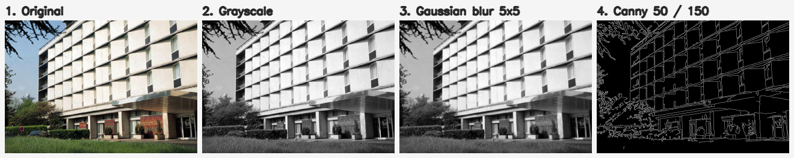
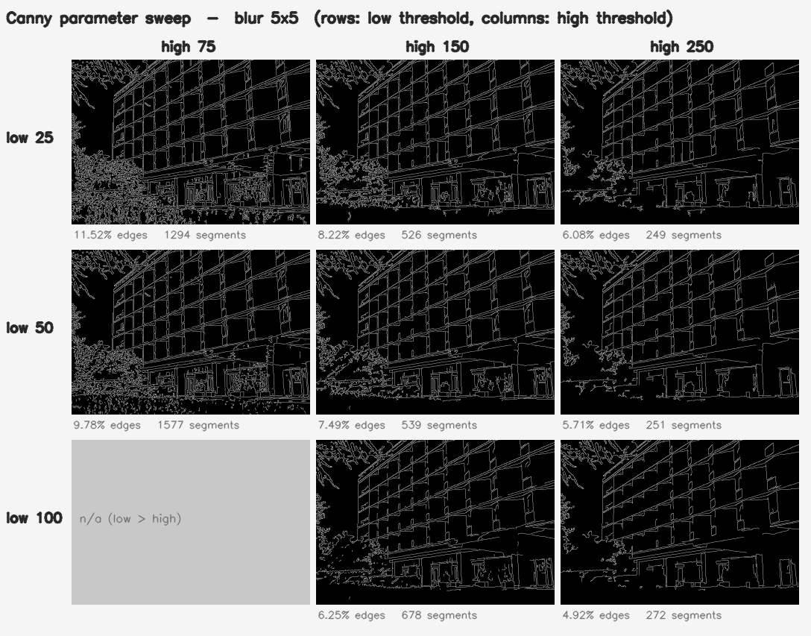
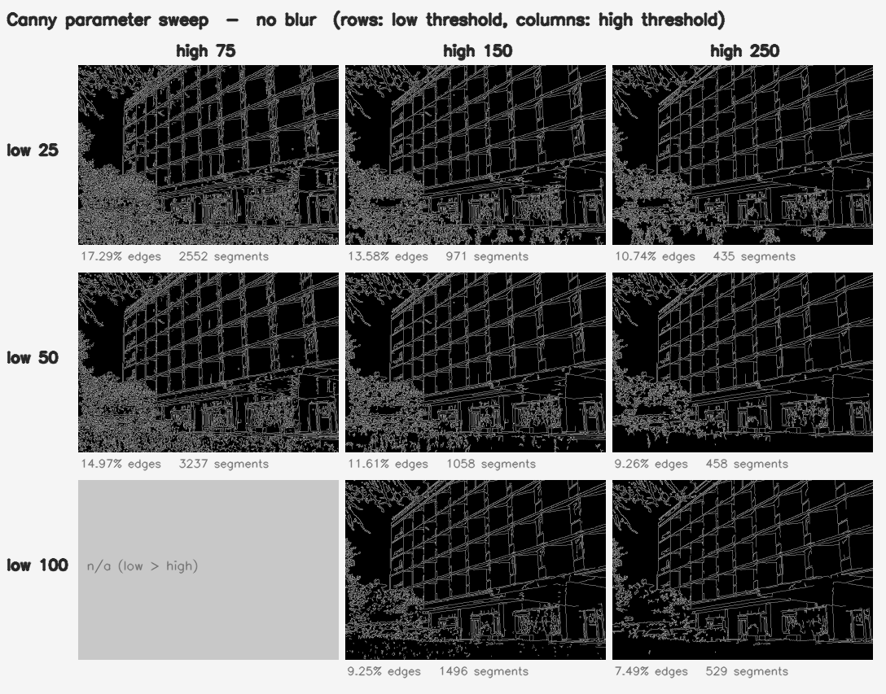

# Experiments: parameter comparison and performance

All numbers below come from one run of `./scripts/run_all.sh`. The raw output and CSVs are in `results/`.

**Machine:** Intel Core i5-1245U (10 cores: 2 performance + 8 efficiency, 12 threads), laptop. WSL2 Ubuntu 24.04, g++ 13.3 `-O3` (Release), OpenCV 4.6.0 built with core/imgproc/imgcodecs only (no IPP, no OpenCL).

Laptop timings vary from run to run because of turbo boost and heat, so treat differences of about 10–20 % as noise. The tables show the mean and the fastest (min) run.

---

## Upgrade 1: How parameters affect the edges

```bash
./build/imgproc compare data/building.jpg -o results/compare --csv results/compare_building.csv
./build/imgproc compare -o results/compare     # synthetic 1280x720 image
```

`compare` runs every combination of **Gaussian blur** (none, 3×3, 5×5, 9×9), **low threshold** (25, 50, 100) and **high threshold** (75, 150, 250). That's 32 settings, since low > high is skipped. It measures three things for each edge map:

- **Edge density**: the percentage of pixels marked as edges.
- **Segments**: the number of separate connected edge pieces. Fewer, longer segments mean cleaner outlines, while thousands of tiny segments mean noise and texture.
- **Time**: blur plus Canny, averaged over 5 runs.

### The pipeline, stage by stage



### Effect of the thresholds (5×5 blur)

Each row is a low threshold and each column a high threshold:



### Effect of blur (no blur vs 5×5 above)



### Numbers: `building.jpg` (868×600 photo)

| Blur | Low / High | Edge density | Segments |
|------|-----------:|-------------:|---------:|
| none | 50 / 150 | 11.61 % | 1058 |
| 3×3  | 50 / 150 | 8.89 % | 692 |
| 5×5  | 50 / 150 | 7.49 % | 539 |
| 9×9  | 50 / 150 | 5.01 % | 394 |
| 5×5  | 50 / 75  | 9.78 % | 1577 |
| 5×5  | 50 / 250 | 5.71 % | 251 |
| 5×5  | 25 / 150 | 8.22 % | 526 |
| 5×5  | 100 / 150 | 6.25 % | 678 |

### Synthetic image (shapes + Gaussian noise σ = 8)

| Blur | Low / High | Edge density | Segments |
|------|-----------:|-------------:|---------:|
| none | 25 / 75  | 13.33 % | 4343 |
| none | 50 / 150 | 0.61 % | 17 |
| 3×3  | 25 / 75  | 0.63 % | 18 |
| 5×5  | 50 / 150 | 0.48 % | 10 |
| 9×9  | 50 / 250 | 0.08 % | 2 |

### What this shows

1. **Blur is the main defence against noise.** On the synthetic image, no blur with low thresholds (25/75) marks 13 % of pixels as edges in 4,343 fragments, which is almost all noise. A 3×3 blur alone cuts that to 0.6 % and 18 segments, and those are the real shape outlines.
2. **Too much blur erases real edges.** A 9×9 blur with a high threshold of 250 keeps only 2 segments on the synthetic image. The blurred shape borders no longer have a strong enough gradient to pass the high threshold. On the photo, a 9×9 blur halves the edges compared with no blur (11.6 % → 5.0 %) and loses fine detail in the windows and the tree.
3. **The high threshold decides which edges start.** Raising it from 75 to 250 (5×5 blur, low 50) drops density from 9.8 % to 5.7 %, and segments fall from 1,577 to 251. Only strong outlines such as the building's grid survive, and the foliage texture disappears.
4. **The low threshold decides how far edges extend.** Raising it from 25 to 100 (high 150) drops density from 8.2 % to 6.25 %, but segments *increase* from 526 to 678. Edges break into more pieces because weak pixels that used to join strong ones are dropped.
5. **A narrow gap between low and high (50/75) gives the most fragments.** Too many weak pixels become seeds, and grass and leaves turn into thousands of short pieces.
6. **Parameters barely change the speed.** Every setting took 1.5–7.6 ms on the photo. The differences are mostly timing noise, plus a little extra for the larger blur kernels. Picking parameters is a quality decision, not a speed decision.

**Good default for photos:** a 5×5 blur with 50/150 (the app's default), giving a clean structure with little texture noise. For noisy images use a larger blur. For a sketch with only strong outlines, raise the high threshold.

---

## Upgrade 2: Performance and concurrency

### Image size vs processing time (in memory, no disk I/O)

```bash
./build/imgproc bench --iterations 50                 # OpenCV multi-threaded
./build/imgproc bench --iterations 50 --threads 1     # OpenCV single-threaded
```

Grayscale + blur + Canny, mean of 50 runs after one warm-up:

| Size | Megapixels | 1 thread (ms) | 12 threads (ms) | Speedup |
|------|-----------:|-------------:|---------------:|-------:|
| 320×240   | 0.08 | 0.45  | 0.30  | 1.5× |
| 640×480   | 0.31 | 1.22  | 1.06  | 1.1× |
| 1280×720  | 0.92 | 2.88  | 2.36  | 1.2× |
| 1920×1080 | 2.07 | 6.08  | 5.19  | 1.2× |
| 3840×2160 | 8.29 | 47.17 | 23.14 | 2.0× |

Time grows roughly in proportion to pixel count: about 2.9 ms per megapixel at 1080p. 4K is slower per pixel (5.7 ms/MP single-threaded), probably because its working buffers no longer fit in the CPU cache. OpenCV's own threading only pays off clearly at 4K. For smaller images the work is too short to split efficiently.

### Sequential vs parallel images (full pipeline, with disk I/O)

```bash
./build/imgproc scale --sizes small,medium,large --images 24 --repeats 3
```

For each size, 24 images go through the whole pipeline: load PNG → gray → Canny → save two PNGs. Each mode gets one warm-up run and three timed runs. Images are processed:

- **sequential**: one at a time, OpenCV single-threaded (the baseline);
- **sequential + OpenCV threads**: one at a time, with OpenCV using all 12 threads inside each image;
- **parallel N**: N images at the same time on a pool of `std::thread`s, OpenCV single-threaded inside each.

Speedup is relative to *sequential* (mean wall time):

| Mode | Small 640×480 | Medium 1920×1080 | Large 3840×2160 |
|------|------:|------:|------:|
| sequential (wall time) | 380 ms | 3,169 ms | 9,389 ms |
| sequential + OpenCV threads | 1.02× | 1.40× | 1.00× |
| parallel, 2 workers  | 1.81× | 1.51× | 1.49× |
| parallel, 4 workers  | 1.68× | 2.27× | **2.34×** |
| parallel, 8 workers  | 3.52× | 4.42× | 1.96× |
| parallel, 12 workers | **3.78×** | **4.76×** | 2.23× |
| best throughput | 239 images/s | 36 images/s | 6.0 images/s |

The folder batch test (12 mixed-size images on the Windows drive) gave **5,380 ms sequentially vs 1,155 ms with `--workers 0`** (12 workers), a **4.7×** speedup.

### What this shows

1. **Most of the time is spent on file I/O, not on the algorithm.** At 4K one image takes about 390 ms end to end, but gray + Canny is only about 47 ms of that. The rest is PNG decoding and encoding, which run on a single thread. That is why letting OpenCV use more threads *inside* an image gives almost nothing end to end (1.00–1.40×): it can only speed up the small part.
2. **Processing separate images at the same time is the better approach.** Each worker runs the whole pipeline, including the PNG work, so all the stages run in parallel. That gives 3.8× for small and 4.8× for medium images. Because no image depends on another, the only shared state is a counter saying which image is next.
3. **Large images stop scaling after 4 workers.** With 8 or 12 workers in flight, 4K images use hundreds of MB of buffers and compete for memory bandwidth. This CPU also has only 2 performance cores, and the other 8 are slower efficiency cores, so 4 workers was the best setting at 4K. More threads isn't always faster. Measure it.
4. **Two ways of using threads at once slow each other down.** When N images run in parallel, OpenCV is limited to one thread per image. Otherwise N workers × 12 OpenCV threads would oversubscribe the CPU. `batch --workers N` does this automatically unless `--threads` is given.
5. **Per-image time and total throughput aren't the same thing.** In the parallel batch run each image's own load time went *up* (250–930 ms, because 12 threads share the WSL `/mnt/c` file bridge), yet the whole folder finished 4.7× sooner. For batch work, total time (throughput) is the number that matters.
6. **Small images gain the least from extra threads.** At 640×480 one image takes about 16 ms, so the cost of starting threads and the contention on the file system take up a bigger share. 2 and 4 workers gave almost the same result here, which is within the noise.

### How it was implemented

- `processFolder(dir, out, params, workers)` starts `min(workers, images)` `std::thread`s. Each one takes the next image index from a `std::atomic<size_t>` until the list runs out, so a slow 4K image doesn't hold up the rest.
- Each result is written to its own slot in a pre-sized vector, so no locks are needed and the output order matches the sequential run. The tests check that parallel output is byte-for-byte identical to sequential.
- Errors are caught per image inside the worker, so one bad file can't stop the other threads.
